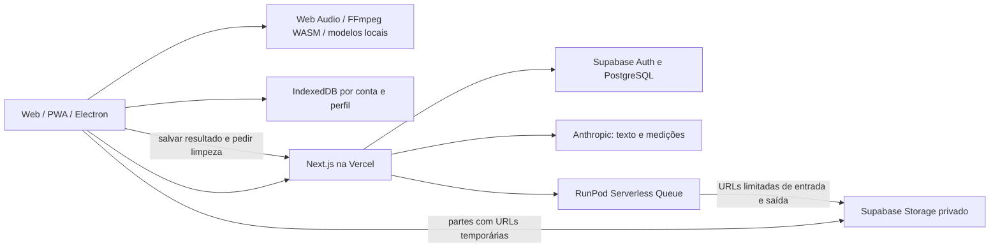

# Arquitetura atual da NOSSOM

Estado documentado em 24/10/2026 UTC. Comece por [handoff/README.md](handoff/README.md). O código e os contratos testados prevalecem sobre textos históricos.

## Componentes e fronteiras de dados

A aplicação tem três caminhos de áudio, que não devem ser confundidos:

| Caminho                    | Execução                            | Dados enviados                                  | Resultado                                                        |
| -------------------------- | ----------------------------------- | ----------------------------------------------- | ---------------------------------------------------------------- |
| Ferramentas locais         | Navegador, workers/WASM             | Não enviam o arquivo ao servidor para processar | Limpeza local, EQ, dinâmica, efeitos, mixagem, medição e entrega |
| Restauração de fala `auto` | RunPod, preset `resemble-d-v1`      | Cópia temporária privada do original            | WAV float32 mono, 44,1 kHz                                       |
| Separação musical `vocals` | RunPod, preset `htdemucs-vocals-v1` | Cópia temporária privada do original            | Stem `vocals`, WAV float32 estéreo, 44,1 kHz                     |

A conversa Anthropic recebe pedido e medições, **não o áudio**. Voz ao vivo ElevenLabs é opcional e usa o microfone apenas quando iniciada pelo usuário. Nenhum modo promete funcionamento offline completo.

## Aplicação e navegação

Next.js 16, React 19 e TypeScript. O lockfile define a versão exata; Node 24 é a referência do CI. Builds usam Webpack por compatibilidade com os workers de áudio. Leia as instruções locais da versão do Next em `AGENTS.md` antes de mudar APIs/framework.

O layout do estúdio mantém `Studio` montado ao trocar a ferramenta. `lib/studio-navigation.ts`, `lib/studio-routes.ts` e `components/studio-link.tsx` usam a History API integrada ao Next para navegação local, incluindo voltar/avançar. Não trocar indiscriminadamente por remount de página, requests RSC ou estado perdido. `project` na URL deve continuar preservado.

Rotas principais:

- `/`: homepage, demonstração real A/B e planos.
- `/entrar`, `/auth/confirm`: acesso e confirmação Supabase.
- `/studio`, `/studio/ia`: assistente com anexo e atalhos para ferramentas reais.
- `/studio/projetos`, `/studio/conta`, `/studio/admin`: projetos locais, conta e administração restrita.
- `/studio/automatico`, `/studio/isolar-voz`: restauração remota e separação musical.
- As demais ferramentas são mapeadas em `lib/studio-routes.ts` e agrupadas em `lib/workflow.ts`.
- `/apps`, `/privacidade`: distribuição e explicação de armazenamento/envio.

## Mapa do código

| Área                      | Arquivos de entrada                                                                                                                                      |
| ------------------------- | -------------------------------------------------------------------------------------------------------------------------------------------------------- |
| Homepage, planos e demo   | `components/landing.tsx`, `components/demo-player.tsx`, `components/plan-cards.tsx`                                                                      |
| Estúdio e projetos        | `components/studio.tsx`, `components/assistant-home.tsx`, `lib/storage.ts`, `lib/history.ts`                                                             |
| Waveform, A/B e seleção   | `components/wave-player.tsx`                                                                                                                             |
| Motor local               | `lib/audio.ts`, `lib/neural.ts`, `lib/declip.ts`, `lib/voice-restoration.mjs`                                                                            |
| Controles e presets       | `lib/presets.ts`, `lib/equalizer.ts`, `lib/broadcast.ts`, `lib/effects.ts`, `lib/voice-presets.ts`, `lib/saved-presets.ts`                               |
| Cliente de jobs           | `lib/cloud-audio.ts`, `lib/restoration.ts`                                                                                                               |
| Orquestração remota       | `app/api/audio/jobs/route.ts`, `lib/server/restoration.ts`                                                                                               |
| Worker e modelo musical   | `Dockerfile`, `workers/restoration/handler.py`, `workers/restoration/vocals.py`                                                                          |
| Conta e sessão            | `app/api/account/route.ts`, `lib/server/account.ts`, `lib/server/supabase.ts`, `proxy.ts`                                                                |
| Planos, cota e ADM        | `lib/server/usage.ts`, `lib/plans.ts`, `app/api/usage/`, `app/api/admin/`, `components/admin-dashboard.tsx`                                              |
| IA de texto               | `components/assistant.tsx`, `app/api/ai/`, `lib/server/managed-agent.ts`, `lib/server/claude.ts`                                                         |
| Saldos externos           | `lib/server/provider-balances.ts`, `app/api/admin/billing/route.ts`                                                                                      |
| Desktop e atualizações    | `desktop/`, `components/desktop-updates.tsx`, `lib/desktop.ts`, `app/api/desktop/version/route.ts`                                                       |
| Marca e motion            | `components/brand.tsx`, `components/cinematic-ribbon.tsx`, `components/signal-field.tsx`, `components/use-ambient-motion.ts`, `app/styles/cinematic.css` |
| Ícones e compartilhamento | `scripts/generate-brand-assets.tsx`, `public/pwa/`, `app/layout.tsx`, `app/manifest.ts`, `app/opengraph-image.tsx`                                       |

## Arquivos e motor local

O original é guardado como Blob; não deve ser sobrescrito por tratamentos. A cópia de trabalho local e os resultados têm formatos diferentes conforme o caminho: não assumir que toda versão é PCM16/48 kHz. Resultados remotos preservam WAV float32/44,1 kHz e o tipo mono/estéreo reportado.

IndexedDB guarda projetos, originais, versões e estado do histórico por ID de conta. Navegador, outro dispositivo e perfil Electron possuem espaços diferentes. Não há backup/sincronização automática dos arquivos. O acesso físico ao mesmo perfil/DevTools não é protegido por criptografia dos blobs.

Importação limitada a 100 MiB e 600 segundos, mono/estéreo, com validação por decodificação. O motor local é serializado por aba; cancelamento termina o processamento em workers e preserva versões salvas. O processamento regional mantém o restante da linha do tempo. Mixagem exige o arquivo inteiro.

A/B iguala o volume de escuta sem alterar o export. As medições devem ser do WAV realmente renderizado; MP3, sinais curtos e alvos de entrega não equivalem a certificação. Detalhes em [audio-engine.md](audio-engine.md).

## Job remoto: contrato que precisa permanecer íntegro

1. A API valida identidade, origem, tamanho/duração e operação permitida.
2. Um job por conta é reservado atomicamente no PostgreSQL; cota e idempotência ficam no servidor.
3. Entrada e saída são divididas em partes de até 20 MiB. O cliente/worker recebe apenas URLs temporárias limitadas ao armazenamento privado permitido.
4. A submissão envia um preset validado. O worker não recebe service role nem aceita URL/modelo arbitrário do cliente.
5. O provedor retorna um ID. Despacho ambíguo não é repetido automaticamente.
6. A consulta reconcilia o estado com o provedor. `queued` não ganha porcentagem inventada.
7. Relatório de saída é validado por preset, canais, taxa, frames, bytes e partes. D usa até 6 partes; vocais estéreo, até 11. O limite de entrada não aumenta.
8. O resultado vira versão local antes da limpeza dos objetos temporários. Retomar um job não deve submeter outra GPU.
9. Cancelamento/falha confirmados devolvem a reserva. Falha de comunicação não autoriza liberar/repetir um job ainda ambíguo.

Estados: `uploading`, `submitting`, `queued`, `running`, `completed`, `failed`, `cancelled`, `released`. O preset confirmado é persistido no `report`; o caminho musical usa esse campo existente, sem nova migração dedicada.

## Autenticação, autorização e IA

Sessão Supabase em cookie HttpOnly criptografado AES-256-GCM; Secure em produção e SameSite=Lax. As APIs revalidam identidade. `user_metadata`, nome, query string e corpo de requisição não concedem ADM. O e-mail administrativo precisa estar confirmado; veja a regra efetiva no servidor e nas migrações.

A IA compartilhada usa Managed Agents, modelo/capacidades verificados e esforço alto. O backend restringe a resposta a operações enumeradas. Tokens de conversa são vinculados ao usuário/login e têm expiração; ferramentas externas do agente ficam desativadas nessa sessão. Não enviar IDs, segredos ou mensagens brutas do provedor à UI. A proposta exige revisão do usuário antes de aplicar.

## Planos e custos

Grátis: 5 min/mês; Essencial: 2 h por R$39/mês; Studio: 6 h por R$99/mês. Ativação manual pelo ADM, sem checkout/cobrança automática. Restauração e separação musical compartilham a franquia, com mínimo de 60 segundos por job. Renovação mensal no fuso `America/Fortaleza`; a migração inicial com nome semanal é histórica.

ADM confirmado tem franquia NOSSOM ilimitada, mas isso não remove custos/limites dos provedores. DSP local não consome minutos GPU. Estimativas de custo de execução não são fatura completa: cold start, idle, armazenamento e tráfego podem estar fora delas. O saldo RunPod é consultado quando permitido; o saldo Claude é indisponível pela integração atual.

## Segurança e compatibilidade

Mantenha as políticas e headers de `next.config.ts`: workers, WASM, áudio, blobs e isolamento dependem deles. Não abra `connect-src`/origens sem analisar a necessidade. Não coloque segredos no prefixo `NEXT_PUBLIC_`, no renderer Electron, em URLs de download ou em logs públicos.

Preserve licenças de FFmpeg, DeepFilterNet, RNNoise, Resemble Enhance, Demucs e dos materiais demonstrativos. Não alegue equivalência ao Adobe, separação perfeita, compreensão auditiva pelo Claude ou qualidade musical homologada apenas por mocks/sinais sintéticos.
